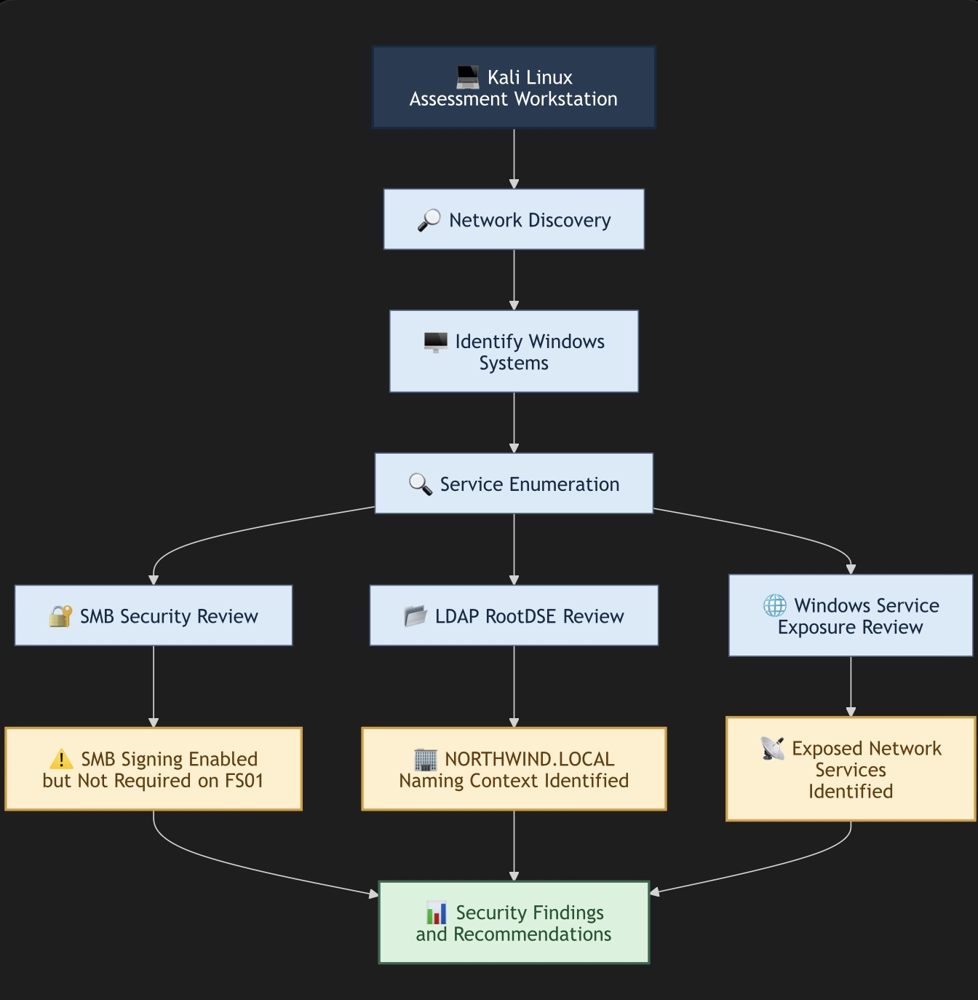

# 🛡 Internal Active Directory Security Assessment

# PENTEST 2 : NORTHWIND.LOCAL

Prepared by: BlackHorizon Security ConsultingClient: Independent LabEngagement Type: Internal Security AssessmentEngagement Date: 16–22 October 2026Consultant: Founder & Security Consultant, BlackHorizon Security Consulting

Classification: Public Portfolio Report

  

## RISK LEGEND

🟥 Critical — Immediate domain or infrastructure compromise risk  
🟧 High — Significant credential exposure or potential privilege escalation  
🟨 Medium — Security weakness or information exposure that may support further attack activity  
🟩 Low — Limited security exposure or informational finding

  

## 📊 Executive Summary

I conducted an internal Active Directory security assessment of the NORTHWIND.LOCAL lab environment. The assessment focused on identifying exposed network services, reviewing directory information and examining selected security configurations across the available Windows infrastructure.

I used a Kali Linux machine as the assessment workstation and examined the domain controller, Windows client and file server within the isolated lab network.

The assessment identified four supported observations. The most significant was that SMB signing was enabled but not required on the FS01 file server. This configuration may create potential NTLM relay exposure under suitable network and authentication conditions.

I also identified the services exposed by FS01 and BOX1 and reviewed the directory naming information returned by LDAP.

The assessment documented the observed configurations and identified practical improvements to reduce unnecessary network exposure and strengthen the security of the environment.

### 🔴 Key Finding

SMB signing was enabled but not required on FS01.

This configuration may expose the server to NTLM relay attacks under suitable conditions. Requiring SMB signing helps protect SMB communications against certain forms of relay and message tampering.

No successful NTLM relay or unauthorised access was demonstrated during this assessment.

  

## 🖥️ Lab Architecture & Environment

### Lab Infrastructure

The assessment was performed in an isolated virtual lab using a host-only network.

|   |   |   |   |
|---|---|---|---|
|System|Operating System|IP Address|Role|
|BOX1|Windows Server 2022|192.168.56.10|Domain Controller|
|Kali Linux|Kali Linux|192.168.56.20|Assessment Workstation|
|Client1|Windows Client|192.168.56.11|Windows Client|
|FS01|Windows Server 2022|192.168.56.12|File Server|

Domain: NORTHWIND.LOCALNetwork: 192.168.56.0/24Network Configuration: Host-only network, with NAT connectivity available to Kali Linux.

Client1 was included in the assessment environment. Its domain membership was not established as NORTHWIND.LOCAL during the evidence review, so I have not treated it as a confirmed member of that domain.

### Initial Access Scenario

I began the assessment from the Kali Linux workstation using the available network access to identify systems and examine exposed services.

I focused on the information and services accessible from the assessment workstation, followed by targeted checks of SMB, LDAP and other Windows network services.

The assessment remained focused on network discovery and configuration review. I did not demonstrate successful initial compromise or unauthorised access.

### Lab Configuration

The lab contained a Windows Server 2022 domain controller and a separate Windows Server 2022 file server.

The FS01 server was identified with the hostname:

WIN-2V7NQPGKT5K

The Client1 workstation was identified with the hostname:

WIN-OHNFQ5F6P9Q

The lab used the 192.168.56.0/24 network for communication between the systems.

I identified NORTHWIND.LOCAL through the SMB enumeration and LDAP naming-context results.

### Assessment Objective

My main objectives were to:

- Identify active systems and exposed network services.
- Review domain-related information returned by LDAP.
- Examine SMB configuration and signing requirements.
- Review the network services exposed by the domain controller and file server.
- Identify security configurations that could increase exposure to common Active Directory attack techniques.
- Document observations and provide practical security recommendations.

  

## 🧭 Attack Path Overview

### Visual Attack Flow

flowchart TD

  

### 📌 Interpretation

I followed a structured assessment process, beginning with network discovery and moving into service enumeration and configuration reviews.

I examined the available information exposed by the Windows systems and reviewed the security controls associated with SMB and LDAP.

The assessment identified a security configuration weakness on FS01 and additional observations concerning directory information and exposed services.

The diagram represents the assessment workflow and the areas examined. It does not represent a confirmed path to domain compromise.

  

## 📊 Risk Overview

|   |   |   |
|---|---|---|
 |Finding|Observation|Risk|
|01. SMB signing on FS01|SMB signing was enabled but not required, creating potential NTLM relay exposure under suitable conditions.|🟧 High|
|02. LDAP RootDSE information|The RootDSE response returned the NORTHWIND.LOCAL naming context.|🟩 Low|
|03. FS01 network services|Multiple Windows network services were reachable on the file server.|🟨 Medium|
|04. BOX1 network services|Multiple domain-related services were exposed on the domain controller.|🟩 Low|

Risk levels represent the configuration and potential impact observed during this lab assessment. They do not indicate that an attack was successfully performed.

  

## 1. SMB Signing Not Required on FS01 🟧

Affected System: FS01IP Address: 192.168.56.12Service: SMB (TCP/445)Risk Level: 🟧 High

### Observation

I examined the SMB configuration on the FS01 file server.

The assessment identified that SMB signing was enabled as a supported capability but was not required.

The Nmap SMB security-mode check indicated:

- Message signing enabled
- Message signing not required

The SMB protocol enumeration also identified support for the following dialects:

- SMB 2.0.2
- SMB 2.1.0
- SMB 3.0.0
- SMB 3.0.2
- SMB 3.1.1

These observations indicate that SMB signing was not enforced on FS01.

Evidence placement: Place the screenshot showing the SMB security-mode result immediately after this observation.

[View FS01 SMB Security Scan](evidence/FS01-smb-security.nmap)

View FS01 SMB security scan

### Interpretation

SMB signing helps protect SMB communication by applying cryptographic signatures to messages exchanged between systems.

When signing is not required, an attacker may be able to exploit certain NTLM authentication scenarios to relay authentication attempts to another service.

The practical exposure depends on the network environment, available authentication traffic and the configuration of other systems.

The identified configuration represents potential exposure. It does not confirm that an NTLM relay attack was successfully performed.

### Business Impact

If an attacker can take advantage of this configuration under suitable conditions, the server may be exposed to NTLM relay techniques.

This could potentially allow unauthorised access to services or resources, depending on the permissions associated with the relayed authentication.

### Risk

🟧 High – Potential NTLM Relay Exposure

SMB signing was not required on FS01, creating a configuration weakness that should be addressed.

### Recommendation

- Require SMB signing on FS01.
- Review SMB signing requirements across all Windows servers.
- Disable SMBv1 where it is not required.
- Reduce unnecessary NTLM authentication.
- Review NTLM usage and apply appropriate restrictions.
- Monitor SMB authentication activity for unusual behaviour.

  

## 2. LDAP RootDSE Information Exposure 🟩

Affected System: BOX1IP Address: 192.168.56.10Service: LDAP (TCP/389)Risk Level: 🟩 Low

### Observation

I examined LDAP information on the domain controller.

The RootDSE query returned the following naming context:

DC=northwind,DC=local

The LDAP response completed successfully and returned one entry.

This confirmed the directory naming context associated with the NORTHWIND.LOCAL environment.

The available RootDSE evidence does not, by itself, establish that the query was performed anonymously. I therefore do not classify this observation as confirmed anonymous LDAP access.

Evidence placement: Place the screenshot showing the LDAP RootDSE response immediately after this observation.

Evidence file: E05-ldap-rootdse.txt

View LDAP RootDSE output

### Interpretation

RootDSE provides information about the LDAP directory service, including directory capabilities and naming-context information.

The naming context returned by the query provides useful information about the directory structure.

However, the disclosure of a naming context alone does not mean that the full Active Directory database or its user information is exposed.

### Business Impact

Directory naming information may provide limited reconnaissance value by helping an attacker identify the domain structure.

The observed information does not demonstrate unauthorised access to protected directory objects.

### Risk

🟩 Low – Directory Information Exposure

The information returned provides limited domain context. No unrestricted directory access was established through this evidence.

### Recommendation

- Review LDAP access permissions.
- Ensure directory information is available only as required.
- Review LDAP signing requirements.
- Consider LDAP channel binding where supported.
- Monitor LDAP activity for unusual queries.

  

## 3. Exposed Network Services on FS01 🟨

Affected System: FS01IP Address: 192.168.56.12Operating System: Windows Server 2022Risk Level: 🟨 Medium

### Observation

I examined the network services exposed by the FS01 file server.

The following TCP ports were identified as open:

|   |   |   |
|---|---|---|
|Port|Service|Description|
|135|MSRPC|Microsoft Remote Procedure Call|
|139|NetBIOS-SSN|NetBIOS Session Service|
|445|SMB|Server Message Block|
|5985|WinRM / HTTP|Windows Remote Management|

Additional tested ports were reported as filtered.

Evidence placement: Place the screenshot showing the FS01 service enumeration immediately after this observation.

[FS01-services.nmap](evidence/FS01-services.nmap)

View FS01 service scan

### Interpretation

These services support normal Windows server operations and remote administration.

However, exposed services increase the number of network entry points that administrators must secure and monitor.

SMB and RPC are particularly important to review in a Windows environment because their exposure may provide access to functionality or information depending on authentication and permissions.

The presence of WinRM on TCP/5985 does not by itself demonstrate that remote administrative access is available to an unauthorised user.

### Business Impact

Unnecessary or poorly restricted network services can increase the attack surface of a server.

If a service is accessible from untrusted network segments or has weak authentication controls, it may create additional opportunities for unauthorised access.

### Risk

🟨 Medium – Network Service Exposure

The exposed services should be reviewed against the intended role and access requirements of FS01.

### Recommendation

- Restrict SMB, RPC and WinRM access to trusted network segments.
- Disable services that are not required.
- Apply firewall rules based on the server’s operational role.
- Restrict remote administration to authorised systems and accounts.
- Review Windows service configurations and authentication requirements.
- Monitor connections to administrative services.

  

## 4. Exposed Network Services on BOX1 🟩

Affected System: BOX1IP Address: 192.168.56.10Operating System: Windows Server 2022Role: Domain ControllerRisk Level: 🟩 Low

### Observation

I examined the network services exposed by BOX1, identified as the Windows Server 2022 domain controller.

The Nmap service enumeration identified the following open ports:

|   |   |   |
|---|---|---|
|Port|Service|Description|
|53|DNS|Domain Name System|
|88|Kerberos|Kerberos authentication|
|135|MSRPC|Microsoft Remote Procedure Call|
|139|NetBIOS-SSN|NetBIOS Session Service|
|389|LDAP|Lightweight Directory Access Protocol|
|445|SMB|Server Message Block|
|464|kpasswd5|Kerberos password change|
|593|RPC over HTTP|Remote Procedure Call over HTTP|
|636|LDAPS|LDAP over SSL/TLS|
|3268|LDAP Global Catalog|Active Directory Global Catalog|
|3269|LDAPS Global Catalog|Secure Global Catalog|

The SMB enumeration also identified SMB signing as enabled and required on BOX1, with SMBv1 disabled.

Evidence placement: Place the screenshot showing the BOX1 SMB enumeration immediately after this observation.

Evidence file: E04-smb-enumeration.txt

View BOX1 SMB enumeration

### Interpretation

The identified services are commonly associated with Windows domain controller functionality.

DNS, Kerberos, LDAP and SMB support domain services, authentication and directory communication.

The presence of these services is not automatically a vulnerability. Their exposure should be evaluated according to the network segments and systems that require access to them.

The SMB enumeration also identified security settings that differ from those observed on FS01.

### Business Impact

A domain controller provides central authentication and directory services. Unnecessary access to its network services could increase the infrastructure’s exposure.

Restricting access to the systems and networks that require these services helps reduce unnecessary attack surface.

### Risk

🟩 Low – Domain Controller Service Exposure

The observed services are consistent with domain controller functionality. The assessment did not establish unauthorised access through these services.

### Recommendation

- Restrict domain controller services to trusted network segments.
- Apply firewall rules according to the domain controller’s operational requirements.
- Maintain SMB signing enforcement.
- Keep Windows Server security updates current.
- Monitor authentication and directory service activity.
- Review exposed services regularly and disable unnecessary functionality.

  

## 📌 Strategic Security Summary

The NORTHWIND.LOCAL environment demonstrated several security configurations that should be reviewed as part of routine Windows infrastructure hardening.

The main area requiring attention is the SMB signing configuration on FS01. The remaining observations provide a basis for reviewing network access restrictions and directory service exposure.

The assessment did not demonstrate a successful compromise of the domain, credential theft or lateral movement.

The findings should therefore be treated as configuration and exposure observations, with remediation focused on reducing unnecessary access and strengthening existing security controls.

  

## 🎯 Business Impact

The observations identified during this assessment are relevant to three main areas of infrastructure security:

- Authentication protection: SMB signing requirements influence the integrity of SMB communication and can help reduce certain authentication relay risks.
- Infrastructure exposure: Network services on servers should be restricted to systems and users that require them.
- Directory security: Information returned by directory services should be reviewed to ensure that access is consistent with operational requirements.

Addressing these areas can reduce unnecessary exposure and improve the overall security posture of the Windows infrastructure.

  

## 🛠 Strategic Recommendations

### 🔴 Priority 1 – Enforce SMB Signing

- Require SMB signing on FS01.
- Review SMB signing configuration across Windows servers.
- Reduce unnecessary NTLM authentication.
- Monitor SMB authentication activity.

### 🟧 Priority 2 – Reduce Network Exposure

- Review exposed services on FS01 and BOX1.
- Restrict SMB, RPC and WinRM access to trusted systems.
- Apply firewall rules according to server roles.
- Disable services that are not required.

### 🟨 Priority 3 – Review Directory Security

- Review LDAP access permissions.
- Maintain appropriate LDAP signing and channel-binding configurations.
- Monitor directory service activity.
- Review domain controller service exposure regularly.

  

## 📎 Appendix

### Risk Model

The risk levels in this report are based on the observed configuration, potential security impact and the conditions required for exploitation.

|   |   |
|---|---|
|Risk|Meaning|
|🟥 Critical|Immediate domain or infrastructure compromise risk|
|🟧 High|Significant credential exposure or potential privilege escalation|
|🟨 Medium|Security weakness or information exposure that may support further attack activity|
|🟩 Low|Limited security exposure or informational finding|

The risk levels represent the assessment of the identified conditions. They do not indicate that every potential attack scenario was successfully performed.

### Evidence Index

The following evidence files support the observations documented in this report.

|   |   |   |
|---|---|---|
|Evidence ID|Evidence Description|Exact File|
|NW-01|BOX1 SMB enumeration and domain identification|E04-smb-enumeration.txt|
|NW-02|LDAP RootDSE naming context|E05-ldap-rootdse.txt|
|NW-03|FS01 service enumeration|FS01-services.nmap|
|NW-04|FS01 SMB signing security-mode check|FS01-smb-security.nmap|

Evidence placement in the report:

- NW-01: Finding 4, Observation.
- NW-02: Finding 2, Observation.
- NW-03: Finding 3, Observation.
- NW-04: Finding 1, Observation.

### 🛠 Tools & Technologies

|   |   |
|---|---|
|Tool / Technology|Purpose|
|Kali Linux|Assessment workstation|
|NetExec (NXC)|Network and SMB enumeration|
|Nmap 7.95|Network discovery and service enumeration|
|SMB|File-sharing protocol and signing configuration review|
|LDAP|Directory service information review|
|PowerShell|Windows security configuration review, where supported by the available evidence|
|Windows Server 2022|Domain controller and file server platforms|
|Windows Client|Client system within the lab|
|Oracle VirtualBox|Virtual lab environment|

### Assessment Environment

|   |   |
|---|---|
|Item|Details|
|Domain|NORTHWIND.LOCAL|
|Domain Controller|BOX1|
|Domain Controller IP|192.168.56.10|
|Assessment Workstation|Kali Linux|
|Assessment Workstation IP|192.168.56.20|
|File Server|FS01|
|File Server IP|192.168.56.12|
|File Server Hostname|WIN-2V7NQPGKT5K|
|Client System|Client1|
|Client IP|192.168.56.11|
|Client Hostname|WIN-OHNFQ5F6P9Q|
|Network|192.168.56.0/24|
|Network Type|Host-only|

  

## Disclaimer

This report documents the security observations identified during an independent Active Directory lab assessment conducted by BlackHorizon Security Consulting.

The assessment was performed in a controlled virtual environment for educational, technical and professional portfolio purposes.

The findings and recommendations are based on the configurations and evidence reviewed during the assessment. They should not be interpreted as confirmation that every potential attack scenario was successfully performed.

This report is intended to demonstrate practical security assessment methodology, technical analysis, evidence documentation and security recommendations.

BlackHorizon Security Consulting  
Internal Security Assessment | NORTHWIND.LOCAL
